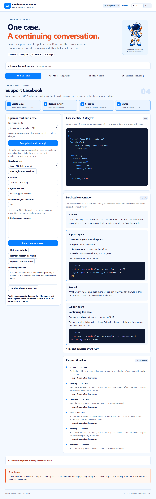
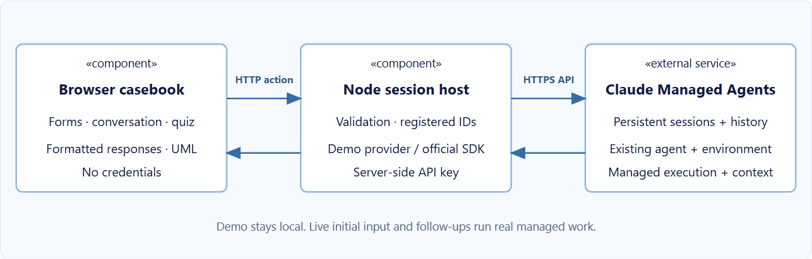

# Lesson 04 · Support Casebook

A practical companion to **Lesson 4: Sessions**, by Luis Coco Enríquez. Create a support case, recover its conversation, continue with the same session ID, update labels and budget, and deliberately archive or delete it.

All live AI execution uses **Claude Managed Agents through the official Anthropic SDK**. The frontend uses TypeScript, Vite, sanitized rich text, and highlight.js. There is no local Claude Agent SDK process or alternate AI provider.



## Run locally

Requires Node 24 (see `.nvmrc`). From this repository:

```powershell
npm ci
npm run dev
```

Open **http://127.0.0.1:4324**. The default guided demo requires no credentials and uses explicitly scripted replies. Click **Run guided walkthrough**.

For real managed sessions, create `.env` from the example:

```powershell
Copy-Item .env.example .env
# Configure ANTHROPIC_API_KEY, MANAGED_AGENT_ID, MANAGED_ENVIRONMENT_ID
npm run dev
```

Use existing agent/environment definitions from Lessons 2 and 3. Prefer a tool-free support coach with a budget-compatible model and a limited cloud environment. Live initial messages and follow-ups consume account usage. The default list-cost ceiling is 125 USD cents ($1.25); it is not a turn limit or preflight cost estimate. Credentials stay in Node; restart after editing `.env`. No credential is distributed with this app.

## Student journey

1. Create Maya’s case with typed initial input, metadata, and budget.
2. Retrieve details: observe that this does not send a message.
3. Refresh persisted history: recover any early reply to `initial_events`.
4. Send the prepared follow-up to the same ID and refresh as work progresses.
5. Patch title, project metadata, and the existing budget while retaining the conversation.
6. Create a second empty case to demonstrate isolation.
7. In demo mode, archive with the exact title; then delete with the separate `DELETE title` phrase.

Archive is terminal but retains history. Delete removes session-scoped data; save needed output beforehand. Agent and environment definitions are independent resources. Archive-before-delete and idle-only edits are this app’s guards, not universal SDK restrictions.

## Teaching structure

Four tabs match the earlier practical apps: session lab, API & configuration, How it works, and quiz. All 14 method/parameter cards have expandable colored TypeScript examples. Responses render as formatted text with highlighted code. The UML component architecture and swimlane workflow include eight selectable explanations and code samples. Comfortable/Larger text controls and responsive layouts support classroom projection and mobile use.



## Observation and persistence

This lesson reads `sessions.events.list` rather than attaching a stream after creation. Persisted history avoids missing fast replies that precede observation. Refresh to see later progress. Message acceptance and idle status alone do not prove completion; inspect event stop reasons. Streaming is covered separately in the course.

Live session IDs are registered in ignored `.data/sessions.json`; after restart use **List registered sessions**. Only registered IDs can be inspected or mutated. Demo data resets on restart. Traces and conversation snapshots are kept in memory, not committed. Reading up to 10,000 events per history refresh is supported; larger exports should use the SDK directly.

This is a single-instructor loopback app, without multi-user authentication. It does not upload files, create memory stores, or manage resources from other lessons. Resource cards demonstrate valid create parameters using existing IDs without executing them.

## Validation

```powershell
npm run check
npx playwright install chromium
npm run test:e2e
```

Backend tests cover continuity, isolation, validation, lifecycle safeguards, persistent ID registration, and actual SDK calls against an in-memory HTTP mock, including pagination and beta headers. Browser tests cover desktop/mobile walkthroughs, every code card, UML, keyboard tabs, quiz, text size, safe rendering, and lifecycle confirmations. Live credentials and a real account are not used by tests.

```powershell
npm run build
npm start
# Optional: starts one real session using your configured definitions:
npm run example
```

## Source layout

- `src/server`: local HTTP host, validation, demo/live providers, and owned-ID registry.
- `src/shared/lesson.ts`: lesson data, typed payload builder, API cards, and quiz.
- `src/client`: course UI, sanitized formatting, code highlighting, and native SVG UML.
- `src/examples/session-lifecycle.ts`: standalone real SDK example.
- `test`: SDK/domain tests and browser learner journeys.
- `docs`: instructor notes, visual guidance, validation, and real application screenshots.

The official SDK is pinned to 1.6.0. Managed endpoints automatically send `managed-agents-2026-04-01`. Check the installed types and official documentation together when upgrading.

References: [Start a session](https://platform.claude.com/docs/en/managed-agents/sessions), [Session operations](https://platform.claude.com/docs/en/managed-agents/session-operations), [Session API](https://platform.claude.com/docs/en/api/http/beta/sessions). Course styling references and MIT asset attribution are in [NOTICE](NOTICE).
